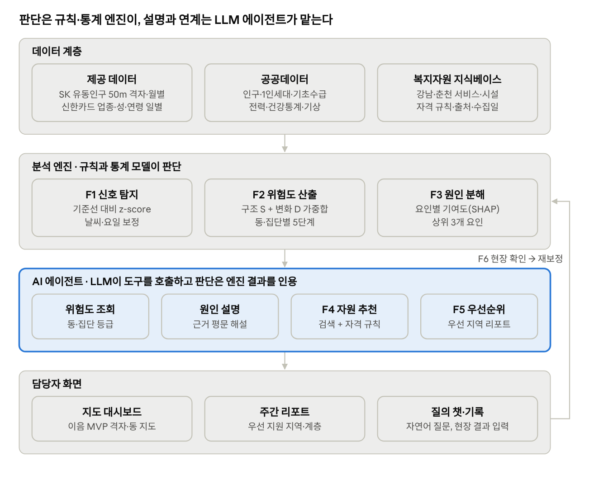

# 사회적 고립 예방·대응 AI 에이전트 설계안

Oct 26, 2026 · @가윤

## 개요

제안하는 에이전트 "이음"은 개인을 감시하는 챗봇이 아니라, 지자체·복지 담당자가 **어느 지역(행정동·격자)의 어느 연령·성별 집단에 어떤 공공·복지 자원을 먼저 보낼지 정하도록 돕는 업무 보조 에이전트**다. 2026 빅콘테스트 AI데이터 활용 분야 주제(사회적 고립 예방 및 대응을 위한 AI 에이전트 개발)의 필수 요소를 그대로 따른다.

- **문제:** 1인 가구 증가와 관계망 약화로 고독사·은둔이 늘지만, 현행 복지 체계는 신청·신고 이후에 움직이는 사후 대응 중심이다.
- **목표:** 제공 데이터(SK 통신 유동인구, 신한카드 소비)와 공공데이터를 결합해 지역·인구집단 단위 **고립 위험도 5단계**를 산출하고, 단계별 개입과 복지자원을 추천한다.
- **운영 흐름(주제 예시와 동일):** 위험 신호 탐지 → 위험 수준 판단 → 위험 원인 분석 → 대응 방안·복지자원 추천 → 우선 지원 대상 지역·계층 도출.
- **범위:** 서울 강남구(22개 동)와 강원 춘천시(25개 읍면동), 2025년 7\~12월. 개인 단위 판정은 하지 않으며, 개인 상담은 담당자가 동의를 받은 뒤 별도 흐름으로 다룬다.

이번 시연은 고위험군인 **60대 남성 1인 가구**를 대상으로 고정하고, 위험도 산출보다 \*\*"어떤 자원을 보낼지"\*\*를 정하는 과정에 집중한다. 고립 판단 지표에는 혼자 식사와 디지털 고립을 새로 넣는다.

평가 배점(아이디어 25, 데이터 근거 25, 사회적 영향 15, 실현 가능성 15, 데이터 지속 활용 10, 완성도 10)에 맞춰, 판단 기준과 위험도 산식을 재현 가능하게 공개하는 것을 설계 원칙으로 삼는다.

## 대상 사용자

에이전트를 직접 쓰는 사람은 공공기관 **담당자**이고, 혜택을 받는 사람은 **고립 위험 주민**이다. 제공 데이터가 비식별 집계본이라 주민 개인을 에이전트가 직접 찾아낼 수는 없으므로, 담당자의 발굴·홍보·상담을 어디에 집중할지 알려주는 것이 핵심이다.

| 구분 | 사용자 | 에이전트에게 필요한 것 | 활용 화면 |
| --- | --- | --- | --- |
| 1차(직접) | 구·시 복지정책과 기획 담당자 | 동별 위험도 순위, 원인 설명, 예산·사업 배분 근거 | 주간 리포트, 지도 대시보드 |
| 1차(직접) | 읍면동 맞춤형복지팀·찾아가는 보건복지 인력 | 이번 주 현장 확인할 격자·시간대, 대상 연령대, 연결할 사업 | 현장 검토 카드, 다음 행동 기록 |
| 1차(직접) | 지역사회보장협의체·복지관·명예사회복지공무원 | 관할 내 홍보·모임 프로그램 추천, 자원 연계 현황 | 자원 추천 목록 |
| 2차(수혜) | 중장년 1인 가구(40\~64세, 특히 남성) | 고독사 위험군. 안부 확인, 일자리·건강 연계 | (담당자를 통해 간접 수혜) |
| 2차(수혜) | 독거 노인(65세 이상) | 노인맞춤돌봄, 경로당·복지관 프로그램 | ″ |
| 2차(수혜) | 청년 1인 가구·은둔 청년(19\~39세) | 청년 마음건강, 사회관계 회복 프로그램 | ″ |

개인 주민이 직접 대화하는 챗봇은 이번 설계의 중심이 아니다. 단, 담당자가 동의를 받은 상담에서 5문항 고립 진단을 대화형으로 보조하는 기능은 이음 MVP의 챗봇처럼 선택 기능으로 둔다.

### 시연 페르소나: 60대 남성 1인 가구

60대 남성은 60\~64세는 중장년 사업, 65세 이상은 노인 사업 대상이라 같은 연령대 안에서도 받을 수 있는 자원이 갈린다. 그래서 두 지역에 나이가 다른 가상 페르소나를 하나씩 둔다. 대회 규칙상 페르소나 기반 가상 데이터는 생성 방식을 설명자료로 제출해야 한다.

| 항목 | 페르소나 A (춘천) | 페르소나 B (강남) |
| --- | --- | --- |
| 기본 정보 | 63세 남성, 춘천 외곽 면 지역 단독주택, 1인 가구 | 67세 남성, 강남구 임대아파트, 1인 가구, 기초연금 수급 |
| 생활 배경 | 퇴직 후 3년, 이혼, 자녀와 연 1\~2회 연락 | 배우자 사별 5년, 경로당 이용 경험 없음 |
| 혼자 식사 | 하루 세 끼 모두 혼자, 편의점 도시락·라면 위주 | 점심만 근처 식당, 저녁은 거름 |
| 디지털 이용 | 스마트폰은 통화만, 메시지 확인 안 함. TV 하루 6시간 이상 | 피처폰 사용, 스마트폰 없음. TV 하루 5시간 이상 |
| 사회적 교류 | 최근 한 달 대화 상대 없음, 외출은 장보기뿐 | 동 주민센터 방문 외 교류 없음 |
| 소득 | 국민연금 소액, 수급 이력 없음 | 기초연금, 차상위 해당 여부 미확인 |
| 집계 데이터에 나타나는 모습 | 해당 면 60대 남성 주간 유동 감소, 편의점 결제 비중 상승 | 해당 동 60대 이상 남성 음식점 1건당 결제액 하락, 심야 활동 비중 상승 |

페르소나는 집계 신호가 어떤 생활 모습에서 나올 수 있는지 보여주는 예시일 뿐이며, 집계 데이터로 이런 개인을 찾아내지는 않는다.

## 핵심 기능

에이전트는 주제의 운영 흐름 5단계에 실행 추적을 더해 6개 기능으로 구성한다. 판단(위험도·자격)은 규칙과 통계 모델이 맡고, LLM은 설명·추천 문안·질의응답만 맡는다.

| # | 기능 | 하는 일 | 결과물 |
| --- | --- | --- | --- |
| F1 | 위험 신호 탐지 | 통신·카드 지표를 지역·성·연령대별 기준선과 비교해 이상 변화 탐지 | 신호 목록(지표, 변화폭, 기간) |
| F2 | 위험 수준 판단 | 구조적 취약도와 활동 변화를 합쳐 고립 위험도 5단계 산출 | 동·격자·인구집단별 등급 |
| F3 | 위험 원인 분석 | 등급에 기여한 상위 요인 분해(기여도·SHAP) 후 LLM이 평문으로 설명 | "왜 이 동인가" 설명 카드 |
| F4 | 대응·자원 추천 | 원인·대상 연령대에 맞는 복지서비스·시설을 검색하고 자격·모집 상태를 규칙으로 대조 | 추천 자원 3\~5개 + 출처 |
| F5 | 우선 지원 대상 도출 | 위험도 × 자원 공백(주변 시설 부족)으로 우선순위 결정 | 주간 우선 지역·계층 리포트 |
| F6 | 실행 추적·환류 | 담당자의 현장 확인 결과·연계 성과를 기록해 가중치·임계값 재보정 | 업무 이력, 모델 개선 데이터 |

### 탐지하는 위험 신호

| 출처 | 신호 | 산출 방식 | 고립과의 연결 |
| --- | --- | --- | --- |
| 통신(연령) | 60대 이상·중장년 유동인구 감소 | 격자별 월 대비 변화율, 지역 평균 대비 z-score | 외출·활동 위축 |
| 통신(시간) | 주간(09\~18시) 활동 비중 하락, 심야 비중 상승 | 시간대 분포의 주간/심야 비율 | 일상 리듬 붕괴, 은둔 |
| 통신(요일) | 주말 활동 감소 | 주말/평일 비율 | 여가·교류 활동 부재 |
| 카드(업종) | 사회적 소비(음식점·카페·문화·여가) 비중 하락, 편의점·주류 비중 상승 | 성·연령대별 업종 구성비 변화 | 타인과 함께하는 활동 감소 |
| 카드(건당) | 1건당 결제액 감소, 결제건수 감소 | 연령대별 일별 추세, 기상·요일 보정 | 1인 소비, 경제적 위축 |
| 카드(시간) | 00\~05시 결제 비중 상승 | 4개 시간대 구성비 | 생활 리듬 이상 |
| 공공 | 1인세대 비율, 고령 1인세대, 기초수급 비율 | 행정동별 월간 비율 | 구조적 취약성 |
| 공공 | 주택용 전력 사용량 급변 | 법정동별 전년 동월 대비 | 재실 시간 증가 또는 빈집화 |

통신 유동인구는 거주인구가 아니고 카드는 가맹점 소재지 기준이므로, 두 지표를 "주민 외출률"처럼 표현하지 않고 **지역 활동 변화**로만 부른다. 폭염·한파·강수일은 기상 일자료로 보정해 날씨 때문의 감소를 고립 신호로 오인하지 않는다.

### 혼자 식사·디지털 고립 지표

두 지표는 개인 행동이라 제공 데이터로 직접 잴 수 없다. 그래서 집단 단위는 **대리 지표**로 추정하고, 개인 단위는 담당자 상담의 **확인 문항**으로 측정한다.

| 지표 | 집단 단위 대리 지표 (에이전트) | 개인 단위 확인 문항 (상담) |
| --- | --- | --- |
| 혼자 식사 | ① 60대 남성 음식점 업종 1건당 결제액 하락(1인분 결제 증가 추정) ② 음식점 대비 편의점·간편식 결제 비율 ③ 식사 시간대(12\~17시, 18\~23시) 음식점 결제건수 추세 | 최근 1주일 동안 다른 사람과 함께 식사한 날은 며칠입니까? (0일 / 1\~2일 / 3일 이상) |
| 디지털 고립 | ① 심야·주간 재실 비중 상승(시간대 유동) ② 시도·연령대별 디지털정보화 수준(과기정통부·NIA 디지털정보격차 실태조사, 추가 수집 후보) ③ 운영 단계: 춘천안심서비스 앱 가입률(기관 협조) | 스마트폰으로 하는 일(없음 / 통화만 / 메시지·영상통화), 하루 TV 시청 시간, 최근 1주일 전화·메시지를 주고받은 사람 수 |

디지털 고립은 기기가 없는 경우뿐 아니라, TV·스마트폰을 오래 쓰지만 다른 사람과의 소통이 없는 **수동적 이용**도 포함한다. 이 구분은 자원 선택에 바로 쓰인다. 예를 들어 스마트폰이 없거나 통화만 하면 앱 기반 안부 서비스 대신 전화·방문형 자원을 추천한다.

### 고립 위험도 산식과 5단계

지수 기준은 [선행 연구 조사 문서](https://claude.ai/artifact/DBHvLLvVUsmeQJY6F8mCQQ)의 '고립 위험 지수 기준(초안)'을 따른다. 분석 단위는 행정동×성×연령 집단이고, 갱신은 월 1회다.

| 영역 | 가중치 | 지표 |
| --- | --- | --- |
| A 외출·이동 감소 | 25% | SKT 남성 60세 이상 유동인구 ÷ 주민등록 인구, 주말/평일 비, 전월 대비 급감 |
| B 혼자 식사 | 20% | 카드 편의점·간편식 건수 비중, 외식 1건당 결제액의 역수 |
| C 관계·여가 | 15% | 카페·주점·스포츠·문화 업종 비중의 역수, 업종 다양성의 역수 |
| D 디지털 고립 | 15% | NIA 연령·성별 디지털정보화 수준의 역수, 온라인 업종 비중의 역수 |
| E 구조적 취약 | 25% | 남성 60대 1인세대 비율, 기초수급 비율 |

```latex
R_{g,t} = 0.25A + 0.20B + 0.15C + 0.15D + 0.25E + 5 \cdot \mathbb{1}[\text{A3 or B1 worsens to top 10\%}]
```

각 지표는 같은 성·연령 집단 안에서 동 간 백분위(0\~100)로 바꾸고 영역 안에서 평균한다. A3(유동 급감)나 B1(편의점·간편식 비중)이 전월 대비 상위 10%로 악화되면 5점을 더한다.

| 단계 | 점수 | 개입 | 에이전트 조치 |
| --- | --- | --- | --- |
| 1 관심 | 0\~39 | 모니터링 | 월간 추세만 기록 |
| 2 주의 | 40\~54 | 홍보 | 원인에 맞는 자원 홍보문 초안, 동 주민센터 배포 제안 |
| 3 경계 | 55\~69 | 참여 프로그램 | 요리교실·소셜다이닝 등 정원 우선 배정 제안 |
| 4 위험 | 70\~84 | 안부 확대 | AI 안부전화 대상 확대, 발굴 조사 요청 |
| 5 심각 | 85 이상 | 방문 조사 | 방문 전수조사 요청, 담당 공무원 승인 후 집행 |

3단계 이상 비중이 60세 이상 고립도 39.4%(사회보장정보원 2025, 선행 연구 문서 인용)에 가깝도록 경계를 보정하고, 이후 F6의 현장 확인 결과로 다시 조정한다. SKT 연령·성별 파일은 60세 이상 남성을 한 구간으로 묶으므로, 60\~64세와 65세 이상은 주민등록 인구 비중으로 나눠 추정한다.

## 60대 남성에게 어떤 자원을 보낼까

에이전트는 자원을 **원인 → 나이 구간 → 자격 → 전달 방식** 순서로 걸러, 고립 원인을 가장 직접 줄이는 자원부터 추천한다. 60대 남성에게는 특히 나이 구간과 디지털 이용 가능 여부가 결과를 크게 바꾼다.

1. **원인 확인:** F3이 낸 상위 요인(혼자 식사, 디지털 고립, 교류·외출 감소, 정서 저하, 경제 위축)을 자원 유형에 대응시킨다.
2. **나이 구간 분기:** 60\~64세는 중장년 사업, 65세 이상은 노인 사업으로 보낸다. 집단 단위에서는 두 구간 비중을 주민등록 연령별 인구로 추정해 둘 다 제시한다.
3. **자격 대조:** 소득·독거 여부 등 조건을 규칙으로 확인하고, 모르는 조건은 "미확인"으로 남긴다. 소득기준이 없는 자원을 앞에 둔다.
4. **전달 방식 필터:** 스마트폰이 없거나 통화만 하면 앱 기반 자원을 빼고 전화·방문·배달형을 올린다.
5. **우선순위:** 원인 직접성 > 자격 확정 여부 > 대기 기간 순으로 상위 3개를 고른다.

### 원인별 자원 대응표 (수집본 기준)

| 고립 원인 | 자원 유형 | 춘천시 | 강남구 | 60\~64세 가능 여부 |
| --- | --- | --- | --- | --- |
| 혼자 식사 | 함께 식사·식사 지원 | 저소득 취약계층 로컬푸드(65세+ 수급 독거) | 무료경로식당(60세+ 수급·차상위, 그 외 실비), 식사·밑반찬 배달(65세+ 독거), 소셜다이닝 | 강남 경로식당·소셜다이닝만 가능 |
| 디지털 고립(기기 없음·통화만) | 전화·방문·배달형 안부 확인 | AI케어콜(65세+ 독거), 우유배달(독거노인·중장년 1인가구) | 노인맞춤돌봄 전화·방문 안전지원(65세+ 소득기준) | 춘천 우유배달 가능 |
| 디지털 역량 부족 | 디지털 교육·일자리 | (수집본에 없음, 추가 조사) | 신중년디지털일자리센터, 찾아가는 정보화교육 | 가능 |
| 스마트폰 사용 가능 | 앱 기반 무활동 감지 | 춘천안심서비스(안드로이드 독거가구) | — | 가능 |
| 교류·외출 감소 | 관계망 프로그램 | 고독사 예방 사업 중장년(19\~64세, 소득기준 없음) | 1인가구 커뮤니티센터 소모임, 노인자원봉사(60세+) | 가능(핵심 자원) |
| 정서 저하 | 심리상담 | (수집본에 없음, 추가 조사) | 정신건강복지센터 8회기 상담(대기 1\~3개월) | 가능 |
| 고독사 고위험(5단계) | 응급 안전 | 응급안전안심서비스(65세+ 독거) | 긴급복지 지원(☎129) | 춘천은 우유배달로 대체 |

근거: [services.csv](https://drive.google.com/file/d/1RbELLWPYLS1M4oQi3VEY5Gvnq6AcioFF/view)(춘천시·강남구 공식 안내 수집본), [강남구 2025 1인가구 종합 지원계획 보도자료](https://drive.google.com/file/d/1s4pRJf0neDjh49dAII1SwtcfF524y2XD/view). 수집본은 현재 정원·모집 상태를 보장하지 않으므로 추천 후 기관 확인이 필요하다. 상세 자원 목록은 선행 연구 문서의 조사 결과로 보완한다.

### 페르소나별 추천 결과

**페르소나 A (춘천, 63세):** 원인은 교류 단절 > 혼자 식사 > 디지털 고립(통화만).

1. 고독사 예방 사업 중장년 프로그램: 안부 확인과 관계망 형성. 64세 이하, 소득기준 없음. 신청은 행정복지센터 또는 춘천효자종합사회복지관.
2. 우유배달사업: 주 3회 배달 후 적체 시 안부 확인. 스마트폰이 필요 없다. 배달 가능 지역인지 확인이 필요하다.
3. 제외: 춘천안심서비스(통화만 해서 앱 활용 어려움), AI케어콜·노인맞춤돌봄(65세 미만). 65세가 되면 자동 재검토 대상에 올린다.

**페르소나 B (강남, 67세):** 원인은 혼자 식사(저녁 거름) > 디지털 고립(피처폰) > 교류 단절.

1. 노인맞춤돌봄서비스: 기초연금 수급이라 대상. 전화·방문 안전지원과 사회관계 향상 프로그램. 강남구노인통합지원센터.
2. 무료경로식당: 차상위 여부가 미확인이라 무료 자격은 보류, 실비 이용은 가능.
3. 1인가구 커뮤니티센터 소모임 또는 노인자원봉사: 식사가 자리 잡은 뒤 교류 확장용으로 제시.

집단 단위에서는 같은 논리로 "춘천 ○○면 60대 남성: 안부 확인+관계망 자원 우선, 식사 지원 차순위" 처럼 자원 유형의 순서를 내고, 담당자는 그 자원의 홍보·발굴을 해당 지역에 집중한다.

## 활용 가능한 데이터

제공 데이터 2종은 모두 쓰고, 팀이 이미 Drive에 모은 무료 공공데이터 8종을 구조적 취약도·보정·검증·추천에 나눠 쓴다. 대회 규칙상 외부 데이터는 출처·수집 방법과 원본 파일을 제출해야 하며, 수집본의 source\_manifest가 이를 충족한다.

| 데이터 | 단위·기간 | 에이전트 용도 | 확보 상태 |
| --- | --- | --- | --- |
| SK 유동인구(성연령·시간대·요일) | 50m 격자(UTM-K), 월별 일평균, 2025.7\~12 | F1 활동 변화 신호 | 제공 |
| 신한카드 소비(주제2용, 법인 제외) | 시군구·업종·성·연령대·거주 시도, 일별 | F1 소비 패턴 신호 | 제공 |
| 주민등록 인구·세대, 성연령별 1인세대(행안부) | 행정동, 월간, 2024\~2025 | S 구조적 취약도, 인구 보정 분모 | 수집 완료 |
| 연령별 인구현황 | 행정동, 월간 | 고령화율, 연령대 가중 | 수집 완료 |
| 국민기초생활수급자·기초연금 수급자 | 서울 동별(2024.5), 춘천(2024.12) | S 경제적 취약성 | 수집 완료(시점 상이) |
| 계약종별·법정동별 전력데이터(한전) | 법정동, 월간, 2024.1\~2025.12 | F1 보조 신호(주택용 전력 급변) | 수집 완료 |
| 시군구 경제활동인구 | 시군구, 반기 | S 고용 취약성 배경 | 수집 완료 |
| 지역건강통계(질병청) | 시군구, 연간 2024·2025 | 위험도 외부 타당도 검증(우울감·스트레스) | 수집 완료 |
| ASOS 일별 기상(서울108·춘천101) | 일별, 2025.7\~12 | 날씨 보정 변수 | 수집 완료 |
| 복지서비스·시설 명부(강남구·춘천시 공식 안내) | 서비스별 대상·내용·연락처 | F4 추천 지식베이스 | 수집 완료(위경도 일부 없음) |
| 복지로 복지서비스 목록 API | 전국, 상시 | F4 자원 확장, 모집 변경 감지 | 미확보(서비스키 필요) |
| 사회조사 사회적 고립도(통계청) | 시도·연령대, 2년 주기 | 연령대별 가중치 근거 | 추가 수집 후보 |

결합 규칙은 수집본 README를 따른다. 행안부 코드(강남 11680, 춘천 51110)와 KOSIS 코드(11230, 32010)는 region\_mapping으로 잇고, 1인세대와 1인가구는 같은 변수로 합치지 않으며, 월 단위 카드값을 격자에 배분하지 않는다. 카드 데이터는 시군구 단위라 동 단위 등급에는 연령대별 추세로만 들어간다.

출처: [2026 빅콘테스트 주제설명자료](https://drive.google.com/file/d/1U8ePHAlnuFslFHiStElQlU59sWY7K2qW/view), [유동인구 테이블 정의서](https://drive.google.com/file/d/1fWwqc-6vZXwGNgzMWaWL3duPzaOPVT9K/view), [신한카드 데이터 레이아웃](https://drive.google.com/file/d/1UuZpdYrjoe-TPMKdiCtWH8YPrjZYAk10/view), [README\_공공데이터](https://drive.google.com/file/d/1mGINWzCs1yFAReyoOq9QPkMlpiNtacUn/view), Drive data 폴더.

## 시스템 구조

시스템은 데이터 → 분석 엔진 → AI 에이전트 → 담당자 화면의 4개 계층이고, 담당자의 현장 확인 결과가 다시 분석 엔진으로 돌아가 가중치를 고친다.



위험 등급과 자격 판정은 분석 엔진과 규칙이 만들고, LLM은 그 결과를 도구로 불러와 설명·추천 문안·리포트로 바꾼다.

| 구성요소 | 역할 | 구현 제안 |
| --- | --- | --- |
| 데이터 파이프라인 | 원본 수집·정제·격자→동 매핑, 월 단위 지표 테이블 생성 | Python(pandas), 기존 collect\_\*.py 재사용 |
| 지표 저장소 | 지역×집단×월 신호·등급·기여도 보관 | DuckDB 또는 SQLite |
| 분석 엔진 | F1\~F3: 이상 탐지, 위험도 산식, SHAP 분해 | scikit-learn, statsmodels, shap |
| 자원 지식베이스 | 서비스·시설을 대상 연령·원인 태그와 자격 규칙으로 구조화 | JSON 규칙 + 벡터 검색(선택) |
| 에이전트 오케스트레이터 | 질문을 받아 도구 4종을 호출하고 답·리포트 작성 | LLM tool use(함수 호출) |
| 담당자 화면 | 지도·리포트·챗·현장 기록 | 이음 MVP(Leaflet 정적 앱) 확장 |

주간 운영 예시: 매주 월요일 에이전트가 지표를 갱신하고, "춘천 신동면 60대 이상 남성, 4단계: 주간 유동 감소와 음식점 소비 비중 하락이 주요 요인, 노인맞춤돌봄서비스와 경로당 프로그램 연결 권고" 같은 카드를 담당자에게 보낸다. 이 문구는 형식 예시이며 분석 결과가 아니다.

## 윤리·개인정보·안전장치

에이전트는 지역과 집단에 대해서만 판단하고, 사람에 대한 최종 판단은 항상 담당자가 한다.

- **개인 판정 금지:** 연령·혼인·거주 형태나 지역 활동량만으로 개인을 "고립자"로 분류하지 않는다. 개인 고립 여부는 동의한 상담에서 교류·지원망 응답으로만 판단한다(이음 MVP 원칙 유지).
- **소집단 보호:** 격자는 원본 50m 격자 5개 이상을 묶은 250m 셀만 표시하고, 작은 값은 가린다. 이 기준은 익명성 보증이 아니므로 운영 전환 시 k-익명성 기준을 따로 정한다.
- **낙인 방지:** 위험도 지도는 담당자 전용이며 외부 공개하지 않는다. 홍보문에 "고립 위험 지역" 같은 표현을 쓰지 않도록 LLM 출력을 검수한다.
- **LLM 역할 제한:** LLM은 설명·문안·검색만 맡고, 위험 등급·자격·모집 판정은 검증된 규칙 결과를 그대로 인용한다. 추천마다 출처 URL과 수집일을 붙이고, 모르는 조건은 "미확인"으로 남긴다.
- **오탐 관리:** 날씨·명절·공사 등 외부 요인을 보정하고, 4단계 이상은 두 개 이상 출처의 신호가 같이 나타날 때만 내린다.
- **외부 전송 없음:** 기관 신청은 담당자가 본인 동의를 받아 직접 하고, 에이전트는 접수 확인 기록만 남긴다. 모든 추천·수정은 감사 이력으로 보관한다.
- **합성 데이터 명시:** 개인 사례 시연에 쓰는 페르소나 데이터는 생성 방식을 문서화해 제출하고, 실제 관측치와 섞지 않는다.

## 평가 지표와 개발 순서

정답 라벨이 없으므로 성능은 "정확도" 대신 타당성·안정성·설명 가능성으로 평가한다.

| 평가 항목 | 지표 | 방법 |
| --- | --- | --- |
| 외부 타당도 | 위험도와 지역건강통계 우울감·스트레스, 1인세대·기초수급 비율의 순위상관 | Spearman 상관, 연령대별 비교 |
| 시간 안정성 | 월별 등급 변동률(급등락 비율) | 인접 월 등급 일치율 |
| 조기 탐지 | 12월 고위험 지역을 7\~10월 자료만으로 예측한 정도 | 시계열 분할 검증, AUC·Precision@k |
| 합성 시나리오 | 페르소나 기반 가상 신호를 주입했을 때 재현율 | 감소폭별 탐지 곡선 |
| 추천 품질 | 추천 자원의 조건 일치율, 출처 제시율 | 담당자 역할 평가 체크리스트 |
| 업무 효과(기대) | 발굴 1건당 소요 시간, 현장 확인 적중률 | 운영 시 F6 기록으로 측정 |

개발은 제출 최소 요구 성과물 4종(인사이트, 분석 근거, 모델링, 에이전트 설계) 순서로 진행한다.

1. **데이터 정비:** 격자→행정동 매핑, 연령대 정의 통일(통신 60대 이상 vs 카드 10세 단위), 기상 보정 변수 결합.
2. **탐색적 분석:** 동·연령대별 신호 분포, 강남·춘천 비교(도시형 vs 도농복합형).
3. **위험도 모델:** S·D 지표 선별, 가중치 초기화, 5단계 경계 설정, 위 평가 지표 산출, 재현 코드 정리.
4. **자원 지식베이스:** services·facilities를 대상 연령·원인 태그로 구조화, 자격 규칙 작성.
5. **에이전트 연결:** LLM 도구 호출(위험도 조회, 원인 분해, 자원 검색, 리포트 작성)과 이음 MVP 대시보드 통합.
6. **시나리오 시연:** 강남 1개 동, 춘천 1개 읍면의 탐지→연계→기록 전 과정을 발표용으로 구성.

미정 사항: 제출 마감일과 팀원별 담당, LLM 제공사 선택, 복지로 API 서비스키 발급 여부.
